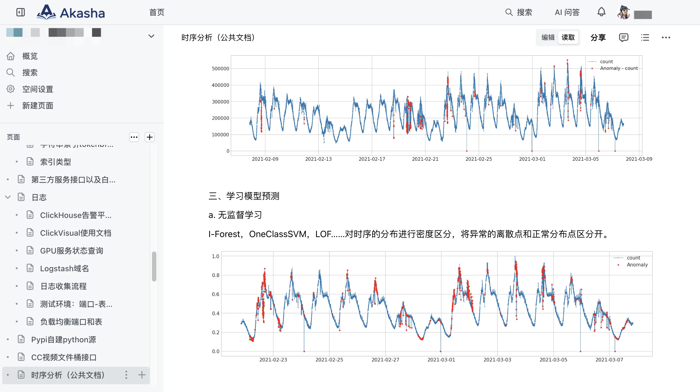
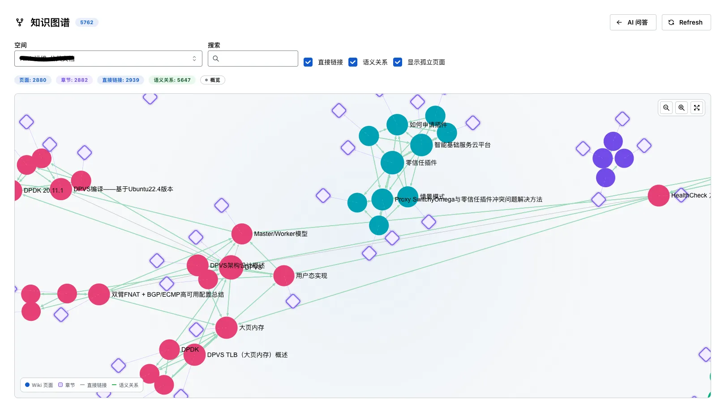

<h1 align="center">Akasha</h1>

<p align="center">
  <strong>A self-hosted knowledge workspace that turns team content into source-grounded, permission-aware knowledge for people and AI agents.</strong>
</p>

<div align="center">
  English / <a href="./README_zh.md">中文</a>
</div>
<br>

<p align="center">
  <a href="./LICENSE"></a>
  
  
</p>

<p align="center">
  
  
  
  
</p>

Akasha helps organizations turn scattered work context and experience into knowledge that can be discovered, connected, reused, and grounded in its sources. Teams collaborate in shared spaces, while agents retrieve and work with organizational knowledge within the same permission boundaries.

It brings together a collaborative Wiki, AI-powered knowledge compilation and retrieval, relationship-aware navigation, and MCP-based agent access in a self-hosted platform.





## Table of Contents

- [Table of Contents](#table-of-contents)
- [Why Akasha](#why-akasha)
- [Features](#features)
- [How It Works](#how-it-works)
  - [Product Method Overview](#product-method-overview)
  - [Technical Processing Flow](#technical-processing-flow)
- [Benchmark Results](#benchmark-results)
- [Roadmap / Vision](#roadmap--vision)
  - [Organizational Memory Beyond Pages](#organizational-memory-beyond-pages)
  - [Compounding Agent Experience](#compounding-agent-experience)
- [Development](#development)
  - [Install](#install)
  - [Start](#start)
  - [Build](#build)
- [Agent Integration](#agent-integration)
  - [Agent-assisted Installation](#agent-assisted-installation)
  - [Manual Installation](#manual-installation)
  - [Verification](#verification)
- [Self-hosted](#self-hosted)
- [Acknowledgements](#acknowledgements)
- [Contributors](#contributors)

## Why Akasha

Most knowledge tools store pages, while most AI assistants retrieve isolated fragments. Akasha connects source material, derived knowledge, people, and agents in one permission-aware system.

- **Wiki-first organizational memory** — Teams keep a familiar collaborative workspace while building a reusable knowledge layer above it.
- **Evidence before answers** — Derived knowledge and AI responses remain connected to source pages and supporting evidence.
- **Structure beyond similarity** — Links, entities, claims, concepts, and relations provide context that keyword or vector similarity alone cannot capture.
- **One knowledge surface for people and agents** — Human and MCP access follow the same workspace and resource permissions.
- **Infrastructure you control** — Akasha is self-hosted, with configurable storage and model endpoints.

## Features

| Area                    | Capabilities                                                                                                                  |
| :---------------------- | :---------------------------------------------------------------------------------------------------------------------------- |
| Collaborative workspace | Spaces, rich-text and Markdown pages, attachments, comments, version history, real-time collaboration, and access control     |
| Knowledge compilation   | Asynchronous page and space compilation into entities, concepts, claims, relations, comparisons, contradictions, and evidence |
| Retrieval and Q&A       | Lexical and vector retrieval, source citations, supporting evidence, and permission-aware results                             |
| Relationship graph      | Visual exploration of direct page links and compiled semantic relationships                                                   |
| Agent integration       | MCP access to knowledge and permitted page, space, comment, attachment, and workspace operations                              |
| Self-hosting            | PostgreSQL with pgvector, configurable model endpoints, and local, S3, or Azure file storage                                  |

## How It Works

Akasha keeps source content and derived knowledge as distinct but connected layers.

### Product Method Overview

<p align="center">
  
</p>

### Technical Processing Flow

<p align="center">
  
</p>

**1. Capture trusted sources.** Teams create Wiki pages or import content into shared spaces. Original pages, attachments, and their permissions remain the canonical source layer.

**2. Compile structure and evidence.** Akasha asynchronously turns selected pages and spaces into entities, concepts, claims, relations, comparisons, and contradictions. Each artifact retains source references and supporting evidence, while indexes make the compiled layer searchable. Compilation augments the original Wiki rather than replacing it.

**3. Retrieve and act.** People search and ask questions through the workspace; agents use MCP. Lexical, vector, and relationship-aware retrieval assemble relevant context, while source permissions continue to govern results. Answers can cite supporting pages, and supported agent operations are recorded for auditing.

## Benchmark Results

Akasha is evaluated on three public multi-hop question-answering datasets using the `qwen-27b` model. `R@5` measures the proportion of gold evidence retrieved in the top five results, while `F1` balances the precision and recall between answer and reference answer.

| Dataset         |       R@5 |        F1 |
| :-------------- | --------: | --------: |
| MuSiQue         | **89.33** | **67.01** |
| 2WikiMultiHopQA |     91.00 |     71.95 |
| HotpotQA        | **99.00** | **87.82** |
| **Average**     | **93.11** | **75.59** |

Under the benchmark configuration currently recorded in this repository, Akasha achieved an average Recall@5 (`R@5`) of **93.11** across MuSiQue, 2WikiMultiHopQA, and HotpotQA, with an average `F1` of **75.59**. These figures describe the recorded retrieval run and should be compared only under consistent dataset and evaluation settings.

See the [complete benchmark comparison and local evaluation toolkit](benchmark/README.md#多跳问答基准综合对比) for baselines, per-dataset results, and instructions for running the evaluation pipeline.

## Roadmap / Vision

The following ideas describe Akasha's product direction. They are exploratory plans and should not be read as a list of features guaranteed to be available in the current release.

### Organizational Memory Beyond Pages

Akasha aims to evolve from a knowledge workspace into a broader organizational memory system:

- **Factual memory** — what happened, supported by source artifacts and provenance;
- **Interaction memory** — why decisions, disagreements, and trade-offs mattered;
- **Action memory** — what actions, workflows, and safeguards should follow.

### Compounding Agent Experience

Akasha may eventually allow reusable agent skills, operating patterns, and execution feedback to accumulate across tasks and agents, so that organizational experience becomes easier to reuse over time.

## Development

### Install

```bash
git clone https://github.com/chaterm/Akasha.git
cd Akasha
pnpm install
```

This repository is a pnpm workspace monorepo. Use `pnpm` for dependency installation and scripts.

Create the local environment file:

```bash
cp .env.example .env
```

Generate a local application secret and set it as `APP_SECRET` in `.env`:

```bash
openssl rand -hex 32
```

Do not commit `.env` or any production credentials to the repository.

### Start

Start PostgreSQL with pgvector using the included Compose service, and provide Redis separately:

```bash
docker compose up -d db
docker run -d --name akasha-redis -p 6379:6379 redis:7
```

Then apply migrations and start the development servers:

```bash
pnpm --filter ./apps/server run migration:latest
pnpm run dev
```

Open [http://localhost:3000](http://localhost:3000). For environment requirements, model configuration, service details, and troubleshooting, see [`docs/development.md`](./docs/development.md).

### Build

```bash
pnpm run build           # Build all workspace projects
pnpm run client:build    # Build the frontend
pnpm run server:build    # Build the backend
```

Build artifacts are generated under the corresponding `apps/*/dist` and `packages/*/dist` directories.

## Agent Integration

Akasha provides an MCP endpoint together with three skills that define when and how agents should use it:

- `akasha-query`: knowledge queries with source citations;
- `akasha-pages`: operations on pages, spaces, comments, and attachments;
- `akasha-weekly-report`: drafting and saving weekly reports.

All requests are subject to Akasha's authorization rules. Before installation, obtain the URL of the deployed Akasha instance and a personal API key, which can be created under **Settings → API keys**.

### Agent-assisted Installation

Send the following instruction to Claude Code, Codex, Cursor, OpenCode, or any other agent capable of executing shell commands:

```text
Install Akasha for me by reading https://raw.githubusercontent.com/chaterm/Akasha/beta/akasha-plugin/install.md
```

By default, the agent installs the skills globally for the host it is running in, then guides you through the MCP configuration. Commands that require approval must be confirmed in the host.

### Manual Installation

Install the skills with the `skills` CLI, which requires Node.js 22.20 or later:

```bash
npx -y skills@latest add https://github.com/chaterm/Akasha.git#beta \
  --skill akasha-query --skill akasha-pages --skill akasha-weekly-report \
  --agent claude-code --global --copy --yes
```

To install for additional hosts, repeat the `--agent` option (`codex`, `cursor`, `opencode`). Where Node.js is unavailable, download [`akasha-skills.zip`](https://raw.githubusercontent.com/chaterm/Akasha/beta/akasha-plugin/dist/akasha-skills.zip) and extract it without modification into the host's skill directory (for Claude Code, `~/.claude/skills/`).

The skills depend on the MCP server and cannot operate until it is registered. For Claude Code:

```bash
claude mcp add --scope user --transport http akasha \
  "https://<your-akasha-host>/mcp" \
  --header "Authorization: Bearer <your-api-key>"
```

For Codex, add the following to `~/.codex/config.toml`:

```toml
[mcp_servers.akasha]
url = "https://<your-akasha-host>/mcp"
http_headers = { Authorization = "Bearer <your-api-key>" }
```

For other hosts, register an HTTP MCP server with the same URL and header according to the host's documentation. The endpoint must end in `/mcp` without an additional `/api` segment. API keys must be stored only in the host's local configuration and must not be committed to a repository or shared in a conversation.

### Verification

Ask a question about internal information, for example "What is our expense reimbursement policy?". The agent is expected to call `query_knowledge` and return an answer with source citations. General questions, such as "What is Redis AOF?", should not invoke Akasha.

Optionally, a default weekly report template and save location can be configured with the `X-Akasha-Weekly-Template-Id` and `X-Akasha-Weekly-Parent-Page-Id` headers on the MCP connection.

For skill development, packaging, and tool contracts, see [`akasha-plugin/README.md`](./akasha-plugin/README.md).

## Self-hosted

Akasha is designed to run in self-hosted environments. Organizations can control where application data, file storage, and AI model endpoints are configured, while applying their own access-control and operational policies.

## Acknowledgements

Akasha builds upon excellent open-source projects. We gratefully acknowledge:

- **[Docmost](https://github.com/docmost/docmost)** — the collaborative Wiki foundation that the workspace and editor layers build on.
- **[OpenDataLoader PDF](https://github.com/opendataloader-project/opendataloader-pdf)** — the PDF parsing engine behind document import.

## Contributors

Thank you for your contribution!
Please refer to the [Contribution Guide](./CONTRIBUTING.md) for more information.
